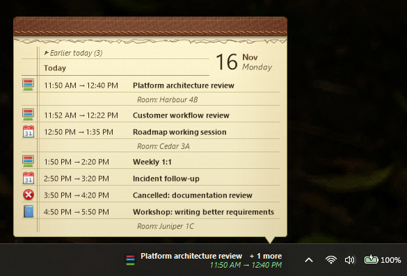
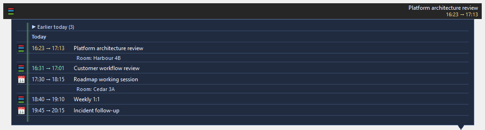
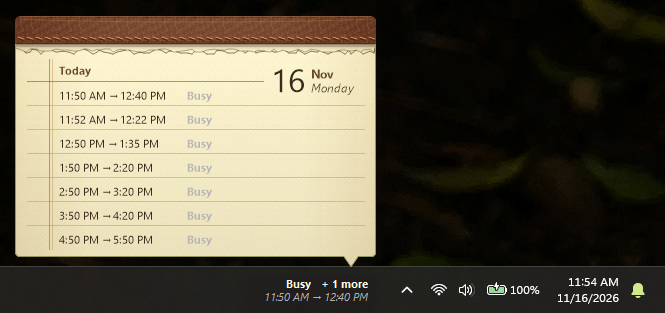

# Taskbar Calendar

Taskbar Calendar shows the next meeting from the default **classic Outlook for Windows** profile in a compact Windows 11 taskbar strip.

It is an Outlook-only fork. It does not use Google Calendar, Microsoft Graph, Chrome profiles, Claude, network monitoring, or an automatic updater.

## Requirements

- Windows 11
- Classic Outlook for Windows installed and signed in once

New Outlook by itself is not supported because it does not expose the local `Outlook.Application` calendar interface used by this app.

## What it does

- Shows the calendar-active meeting first, otherwise the next scheduled meeting.
- Shows overlapping active events as `+ n more` and lists them in the hover card.
- Lets you choose title-first, time-first, or private layouts.
- Shows the meeting start time in either 24-hour or 12-hour format. The taskbar start-time colour is neutral before start, green during the configured grace period, then uses the configurable late-alert colour.
- Opens the Notes-style hover card while the pointer is over either the strip or card. The card has a leather binding, layered torn-paper edge, ruled paper, callout, and configurable corner radius.
- Adds a three-part date stamp to the Notes card. In Settings > Appearance, drag the day number, month, and weekday independently in the preview; their font, colour, formatting, and placement are saved with the theme.
- Reveals a small inline join icon when you hover a joinable current or upcoming meeting row. Clicking it opens that meeting's Outlook invitation link, which launches Teams for a Teams meeting.
- Offers configurable close delay, fade duration, appear animation, transparency, paper/rule settings, fonts, colours, callout, shadow, and empty-day tone.

## Screenshots

### Notes card



### Midnight card



### Busy privacy mode



## Teams privacy mode

The widget can inspect the local Teams call UI to protect calendar details while you present.

- `Busy` replaces meeting names, links, and detail-card content while retaining timing.
- `Hidden` removes the strip and detail card.
- The right-click **Privacy mode** control forces protection on. Turning it off returns control to automatic detection.
- A detected presentation or an unreadable active Teams call is private. This fails closed.

The Teams check is a local UI heuristic, not an official Teams API. Nothing is sent to Teams or Microsoft Graph.

## Install and use

The release is a single EXE. A normal downloaded copy installs per-user into `%LOCALAPPDATA%\Programs\TaskbarCalendar`; a build from `bin` stays in place.

| Action | Result |
|---|---|
| Hover | Opens the upcoming-meetings card |
| Hover a joinable meeting row | Reveals an inline join icon; click it to join that meeting |
| Left-click | Opens Outlook Calendar |
| Right-click | Join the current video call, refresh, control privacy, open settings, or quit |

Settings are stored locally at `%APPDATA%\TaskbarCalendar\config.json`. Logs contain operational messages only and should not contain meeting titles.

## Build and test

```powershell
dotnet test TaskbarCalendar.sln -c Release
dotnet build src/TaskbarCalendar -c Release
```

The executable is written to `src/TaskbarCalendar/bin/Release/net481/TaskbarCalendar.exe` and copied to `dist/TaskbarCalendar.exe` after a normal build.

## Publishing

This repository retains the upstream MIT license and attribution. Review the staged diff and run the CCI/credential scan before publishing. The personal remote must remain private and the corporate remote restricted. The app has no self-update path; releases are installed deliberately.
